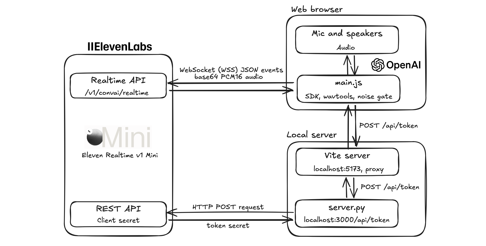
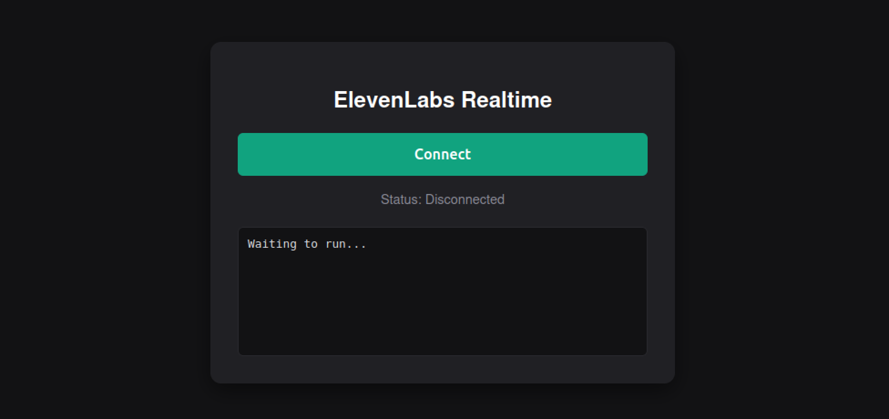

# Connecting OpenAI Realtime client to ElevenLabs Realtime

This example shows how to connect an existing OpenAI Realtime client to ElevenLabs Realtime by changing the endpoint and session configuration.
  


## Architecture components

**OpenAI’s Realtime SDK client ([main.js](main.js))**

It creates a RealtimeAgent and RealtimeSession (OpenAI Agents SDK) with a WebSocket transport pointed at ElevenLabs, then connects with the secret retrieved from Flask server.

**Vite server (port 5173)**

It is a local development server designed to build and serve frontend code. It serves web page with UI and bundles main.js with its npm dependencies (@openai/agents-realtime, wavtools).
It also acts as a proxy and forwards any request starting with /api to Flask, so the browser sees one origin and no CORS setup is needed.

**Flask server (port 3000) ([server.py](server.py))**

This component manages client secret retrieval. It requests ElevenLabs to mint a client secret using a fixed session config (model, voice, instructions, audio format, turn detection) and a 10-minute lifetime.

**ElevenLabs REST API**

It authenticates the request from Flask server using ElevenLabs API key in the xi-api-key header and creates a client secret, which is a short-lived credential tied to the session configuration.

**ElevenLabs Realtime API (WebSocket endpoint)**

It accepts the browser’s WebSocket connection and checks the client secret. It is using the OpenAI Realtime protocol: JSON events carrying base64-encoded PCM16 audio.
It runs the conversation: detects when you’ve finished speaking, generates the agent’s reply, and streams it back as audio chunks plus transcript events and response lifecycle events (response.created, response.done). It sends interruption events when it hears speech during the agent’s answer

**ElevenLabs Realtime WebSocket endpoint**
```
wss://api.elevenlabs.io/v1/convai/realtime
```

## Logic

1. Local server requests a short-lived client secret from ElevenLabs, scoped to a specific session configuration.

  Session parameters:
  - model: eleven_realtime_v1_mini
  - instruction: "You are a helpful, friendly voice assistant. Keep replies concise."
  - audio format: PCM16 audio with rate 24kHz
  - voice: "brian"
2. Client secret is passed to OpenAI’s Realtime SDK in place of an OpenAI API key.
3. The OpenAI’s Realtime SDK connects over WebSocket to ElevenLabs Realtime API, and the conversation proceeds using the same client and server events as OpenAI’s Realtime API.

## Client secret retrieval

1. main.js sends POST request to /api/token to Vite on port 5173.
2. Vite’s proxy forwards /api/token request to Flask server on port 3000.
3. Flask server calls the ElevenLabs REST API. ElevenLabs API key is passed it to the SDKs.
4. ElevenLabs returns a short-lived client secret that is passed to SDK.

## Connection from browser to ElevenLabs Realtime API

main.js opens a WebSocket to ElevenLabs Realtime endpoint and authenticates with the client short-lived secret. It uses the OpenAI Realtime wire protocol: JSON events, with audio carried as base64-encoded PCM16 at 24 kHz.

## Web interface

Once you successfully complete setup, you can access the conversational voice agent by opening a web browser and navigating to http://localhost:5173
Click 'Connect' button and start you conversation with an agent using a speech.



## Setup


```bash
# Create virtual environment
python3.12 -m venv venv
source venv/bin/activate
pip install -r requirements.txt

# Install Vite, Wavtools and OpenAI Agents SDK  
npm init -y 
npm install vite wavtools @openai/agents-realtime 

# Update server.py and add your ElevenLabs API key. 
# You can generate API key at ElevenLabs Platform https://elevenlabs.io/app/settings/api-keys
ELEVENLABS_API_KEY=<KEY>

# Run local Flask server
python server.py

# Check if Flask server is able to establish connection to ElevenLabs platform and retrieve client secret
curl -i -X POST http://localhost:3000/api/token

# Make sure you have a proper server proxy configuration in vite.config.js file
export default {
  server: {
    proxy: {
      "/api": { target: "http://127.0.0.1:3000", changeOrigin: true },
    },
  },
};

# Run Vite server
npx vite

# Open browser and type following address
http://localhost:5173
```

## References
- [OpenAI Realtime API compatibility](https://elevenlabs.io/docs/eleven-agents/guides/openai-realtime-compatibility)
- [OpenAI’s Realtime agents SDK](https://openai.github.io/openai-agents-python/ref/realtime/agent/)


---
Created by [Robert Tracz](https://www.linkedin.com/in/robert-tracz/) 